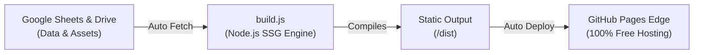

# 🌌 Anti-Gravity Portfolio Platform

A high-performance, automated Jamstack freelance portfolio platform for elite professionals. Defies gravity with ultra-smooth floating physics, real-time 3D tilt interactions, and dark space-ambient aesthetics.

---

## ⚡ Architecture Flow



- **Database:** Google Sheets (Text, Bio, Skills, Rates) + Google Drive (Headshots, Project media).
- **Automation:** GitHub Actions auto-syncs on schedule (every 6 hours) or instant manual dispatch.
- **Routing:** `./dist/professionals/[username]/index.html` + `./dist/index.html` (Marketplace directory).
- **Performance:** 100% pre-rendered static HTML, zero heavy client framework, &lt;40ms build time.

---

## 📊 Google Sheet Column Schema

Create a Google Sheet and name row 1 headers with any of the following:

| Column Name | Example Value | Description |
| :--- | :--- | :--- |
| **Name** | `Aiden Vance` | Full professional name |
| **Username** | `aiden-vance` | Routing slug (generates `/professionals/aiden-vance/`) |
| **Title** | `Zero-G UI/UX Architect` | Professional role or headline |
| **Bio** | `Pioneering spatial web experiences...` | Brief personal biography |
| **Avatar** | `https://drive.google.com/file/d/1A2b.../view` | Google Drive link or external image URL |
| **Skills** | `Three.js, WebGL, UI/UX, React` | Comma-separated list of skills |
| **Rate** | `$95/hr` | Hourly or project rate |
| **Location** | `Global / Remote` | City or timezone |
| **Status** | `Available for Projects` | Live availability indicator |
| **GitHub** | `https://github.com/username` | Optional social URL |
| **LinkedIn** | `https://linkedin.com/in/username` | Optional social URL |
| **Twitter** | `https://twitter.com/username` | Optional social URL |
| **Portfolio** | `https://mywebsite.com` | Optional personal site |
| **Project 1 Title** | `Nebula OS Desktop` | Name of first case study |
| **Project 1 Desc** | `Browser-based 3D workspace...` | Description of project |
| **Project 1 Tags** | `WebGL, Three.js, Canvas` | Comma-separated tags |
| **Project 1 Link** | `https://example.com` | Live demo or case study URL |
| **Project 1 Image** | `https://drive.google.com/file/d/...` | Google Drive share URL |

> [!TIP]
> **Google Drive Links:** Simply right click any image in Google Drive → **Share** → **Anyone with the link can view** → Copy link and paste into your Google Sheet. Our built-in `driveResolver` automatically transforms it into a direct web image stream!

---

## 🚀 GitHub Actions Setup (Auto-Deploy)

### 1. Enable GitHub Pages
1. Go to your GitHub repository → **Settings** → **Pages**.
2. Under **Build and deployment > Source**, select: **GitHub Actions**.

### 2. Configure Repository Secrets (Optional for Private Sheets)
1. Go to **Settings** → **Secrets and variables** → **Actions** → **New repository secret**.
2. Add:
   - `GOOGLE_SPREADSHEET_ID`: (Your Google Sheet ID from URL)
   - `GOOGLE_SERVICE_ACCOUNT_EMAIL`: (Your Google Cloud service account email)
   - `GOOGLE_PRIVATE_KEY`: (Your Google Cloud private key)

*(If your Google Sheet is shared with "Anyone with the link can view", you only need to provide `GOOGLE_SPREADSHEET_ID`!)*

---

## 💻 Local Commands

```bash
# 1. Run local development preview server (http://localhost:3000)
npm run dev

# 2. Compile static production build
npm run build

# 3. Test data authentication & connection
npm run test:auth
```
